### opit

i do websites, servers, llm stuff, etc.

<picture>
  <source media="(prefers-color-scheme: dark)" srcset="https://raw.githubusercontent.com/opit80/opit80/output/contributions-dark.svg" />
  <source media="(prefers-color-scheme: light)" srcset="https://raw.githubusercontent.com/opit80/opit80/output/contributions-light.svg" />
  
</picture>

  <picture>
    <source media="(prefers-color-scheme: dark)" srcset="https://raw.githubusercontent.com/opit80/opit80/main/assets/discord-dark.svg" />
    <source media="(prefers-color-scheme: light)" srcset="https://raw.githubusercontent.com/opit80/opit80/main/assets/discord-light.svg" />
    
  </picture>
  &nbsp;
  

